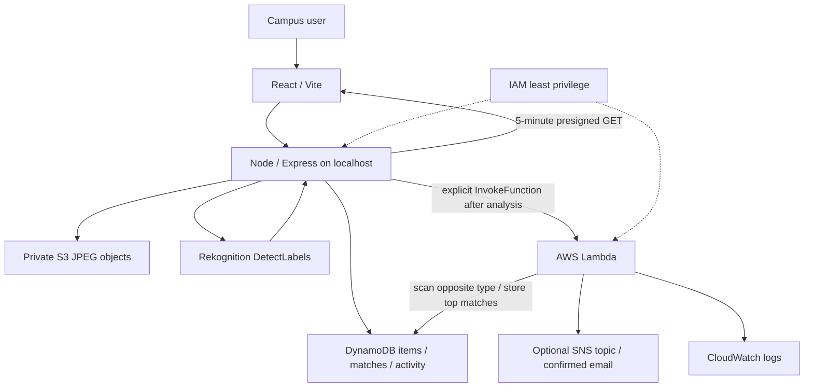

# FindBack architecture

S3 objects never have public URLs or public ACLs. AWS credentials stay in the backend or AWS execution role. Temporary image viewing URLs are generated only on request.

## Records

One table, string partition key `itemId`, no sort key or GSI. Pagination is handled for every DynamoDB scan.

- ITEM: UUID, entity=ITEM, type LOST/FOUND, itemName, description, category, color, location, date, time, imageKey, detectedLabels `{Name,Confidence}`, identifyingFeature (private), ownershipQuestion, ownershipAnswerHash (private), status, analysisStatus, matchingStatus, processingError, createdAt, updatedAt, matchedItemIds list, bestMatchScore, activeClaimMatch.
- MATCH: `MATCH#lostId#foundId`, entity=MATCH, lostId, foundId, score, explanation list `{signal,label,points,max}`, status, timestamps, claimTokenHash (private), claimExpiresAt.
- ACTIVITY: `ACTIVITY#uuid`, entity=ACTIVITY, reportId, service, message, level, createdAt.

`REPORTED → ANALYZED → POSSIBLE_MATCH → CLAIM_REQUESTED → VERIFIED → RETURNED` is the visible lifecycle. Analysis and matching have separate PENDING / PROCESSING / COMPLETE / FAILED flags. A report with no match remains ANALYZED. A no-match result is a successful Lambda execution with zero matches.

## Why explicit Lambda invocation?

The backend controls image validation → upload → record → labels → invocation, making the live demo predictable and errors recoverable. A DynamoDB Stream can fire before labels are available and can self-trigger when statuses change. The permitted explicit invocation design avoids those fragile loops. The project demonstrates serverless cloud execution and a staged processing workflow; it does not claim an event-driven trigger is deployed.

A future Streams extension should enable NEW_AND_OLD_IMAGES, filter ITEM updates where analysisStatus changes to COMPLETE, and invoke only once per analysis version. Add idempotency and failure handling before enabling it. Do not combine both invocation methods without deduplication.

## Scores

The portable scoring module lives alongside Lambda and is imported by backend tests. It does not use Rekognition label confidence as a probability of ownership. Label overlap and text overlap use intersection/union. Exact category and color, a small explicit campus proximity list, and date-time bands provide explainable weights. Missing signals earn zero points.

Recovery rate = returned LOST reports / all LOST reports × 100. Recovered counts owners' lost reports, avoiding counting a returned pair twice. Active matches exclude RETURNED pairs. Location/category charts count LOST reports. All derived metrics come from DynamoDB; there are no seeded application statistics.

## Boundaries

Public API records omit salted answer hashes, claim token hashes and private identifying features. Claim sessions expire in 15 minutes and transitions lock the match and both item records via DynamoDB transactions. This is not user authentication. Local backend binding, request throttles and CORS support a trusted demo; production access controls are future work.

Real cloud service outcomes are stored as application activity. Lambda logs use native CloudWatch logging; the frontend does not impersonate or expose private CloudWatch logs. SNS failures are returned as Failed while matches remain usable.
